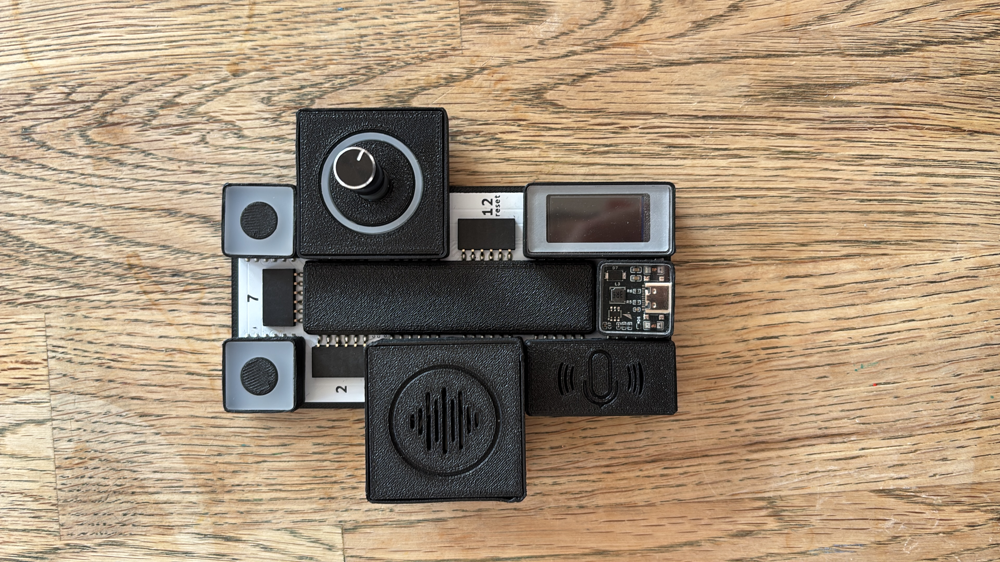
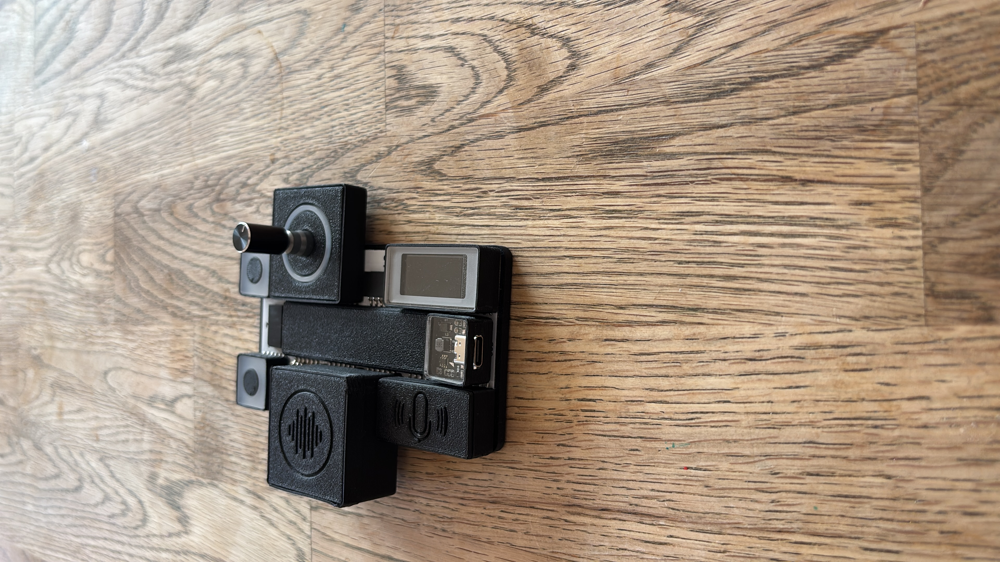
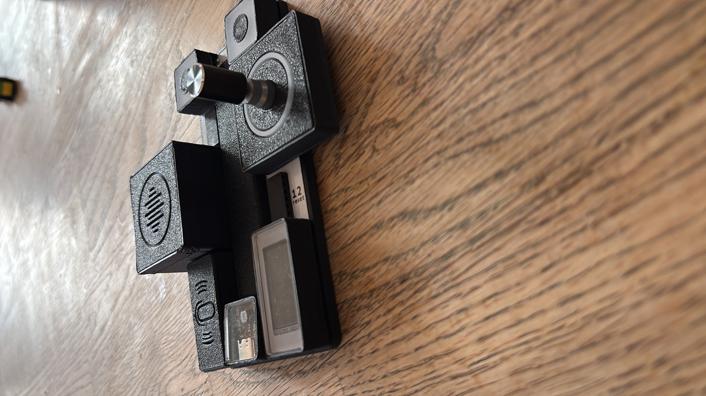
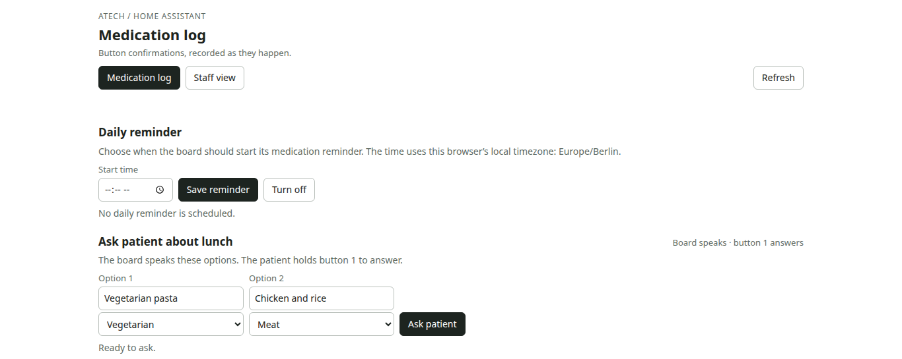
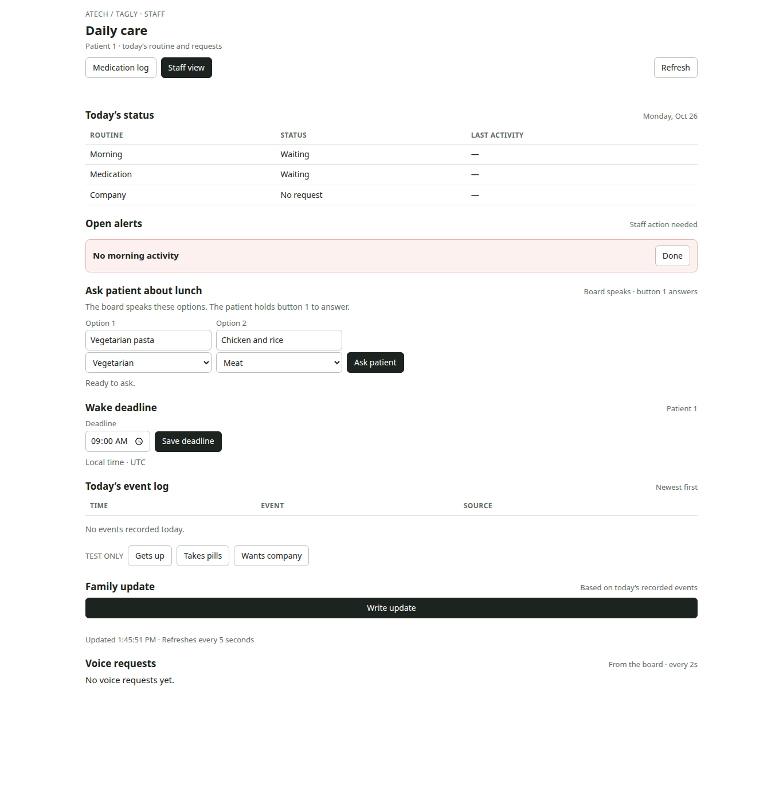

# Atech Home Assistant

A local home-assistance prototype built around a physical button-and-voice device. It connects the device to a medication confirmation log, spoken reminders, voice requests, and a staff dashboard.

## Device







## Dashboard

The medication page shows confirmations and reminder settings. The staff page shows the resident's daily status, alerts, lunch questions, and event log.





## Run locally

Start the dashboard/API:

```sh
python3 dashboard.py
```

Then open:

- <http://127.0.0.1:8000/> — medication log and reminder settings
- <http://127.0.0.1:8000/staff> — staff view

For device communication, the computer and board must be on the same trusted Wi-Fi network. The dashboard API listens on port 8000 without authentication; do not expose it to the public internet.

The voice service is separate and runs on port 8001:

```sh
python3 voice_assistant.py
```

It needs `OPENAI_API_KEY` from the environment or a local ignored `.env` file. Never commit credentials.

## Project guide

- [Device setup and medication logging](MEDICATION_LOGGING.md)
- [Staff dashboard and API behavior](TAGLY.md)
- [Voice assistant setup](VOICE_ASSISTANT.md)
- [Voice tools and API contract](VOICE_TOOLS.md)
- Device firmware and display code: [`slot-8-display/`](slot-8-display/)

The screenshots are examples of the dashboard interface. Buttons marked **TEST ONLY** create simulated events and do not contact the physical device.
